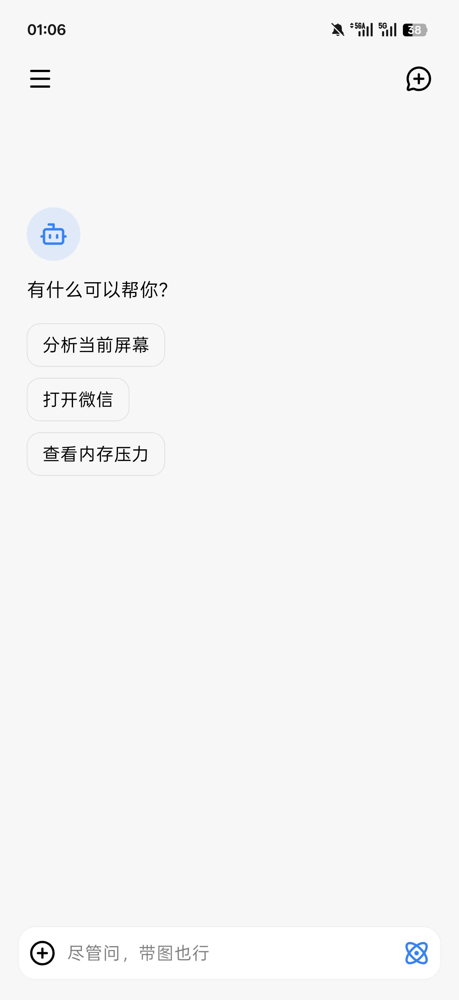
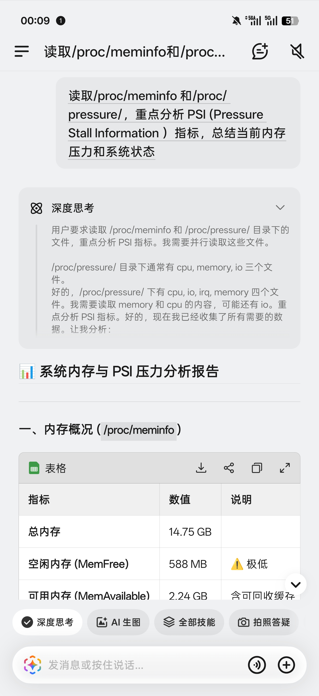
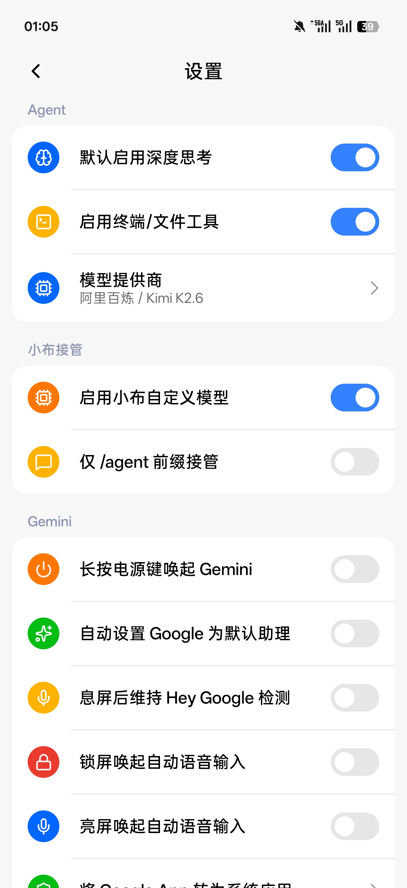
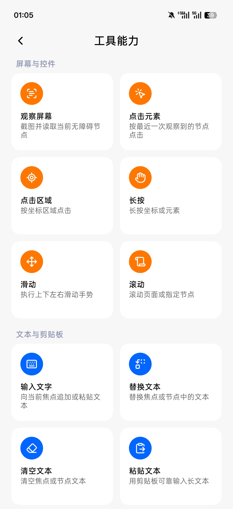
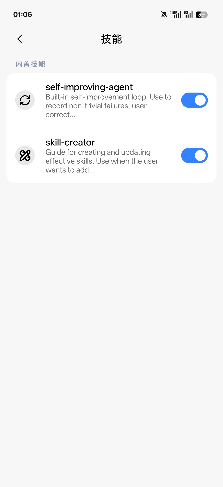

<h1 align="center">Eta</h1>

<a href="README.md">简体中文</a> | <strong>English</strong>

<strong>A third-party, system-level AI assistant for Android</strong>

   

  

Eta is an AI agent designed for phones and other mobile devices. It pairs the autonomous task planning and execution familiar from coding agents such as [Codex](https://openai.com/codex/) with the GUI-driven, cross-app interaction demonstrated by [Doubao Phone Assistant](https://o.doubao.com/). It can work with files, run commands, and write code, and it integrates deeply with Android and OEM apps to retrieve personal context and invoke native system and first-party app interfaces.

Unlike third-party Android agents that stop at accessibility screen tapping or generic root shell execution, Eta benchmarks itself against built-in first-party system assistants from phone makers. With extensive integration across Android system services and OEM first-party apps, its goal is to deliver a true **system-level AI assistant experience**:

- **Personal context:** connects directly to system providers, system databases, ColorOS DMP personalization indexes, and an in-process Xiaobu Memory hook bridge to retrieve location, notification history, app usage statistics, calendar events, photos (including OCR text and visual content index search), contacts, SMS messages and OTP codes, call logs, recordings and transcript summaries, notes, Health Connect summaries, clipboard history, chat images, and OEM data such as Xiaobu Memory, bills and spending summaries, flight/train/hotel itineraries, delivery orders, to-do leads, and saved places.
- **System and first-party app actions:** calls Android APIs and native first-party app interfaces to read and write calendar events (single or batch creation, updates, and deletion), manage alarms (create, reschedule, toggle, delete) and timers, create/read/recycle system notes, and control the flashlight, brightness, screen timeout, ringer and Do Not Disturb, volume, media playback, Night Light and dark mode, Wi‑Fi, Bluetooth, mobile data, personal hotspot, NFC, system settings, and app freezing, reading back and verifying every state change.
- **Native digital assistant and system entry points:** Eta itself is a full Android digital assistant app, so long-pressing the power button wakes Eta directly to start a task with the current screenshot and structured app content automatically attached; Xposed hooks can also route Breeno (Xiaobu) and Super XiaoAI to Eta. Execution progress syncs in real time to the top status capsule and status bar / lock screen Live Updates (Fluid Cloud), alongside unlocking Gemini system assistant and Circle to Search.

Eta implements its own Agent Runtime and Agent Loop to coordinate model requests, tool execution, and feedback, with Skills and MCP available for extensions. You can supply your own model-provider **API key (BYOK)** or sign in with a **Codex (ChatGPT) or Grok subscription**; you choose the model and provider.

Requires **Android 13 or later on ARM64 devices**. The app works across phone brands, and core features do not require root. Root and LSPosed unlock deeper personal context, first-party app interfaces, and assistant integration where permissions and ROM compatibility allow.

[Download APK](https://github.com/Mangi-11/Eta/releases) · [Getting started](#getting-started) · [Why I built Eta](#why-i-built-eta)

## See it in action

| GUI Agent | Breeno with your own model |
| :---: | :---: |
|  |  |

More screenshots: chat, system tools, and settings

| Chat | Commands through Breeno | Direct system API calls |
| :---: | :---: | :---: |
|  |  |  |

| Settings | Tools | Skills |
| :---: | :---: | :---: |
|  |  |  |

## Core capabilities

### Execution tools

- **System and first-party app actions:** call Android APIs and first-party app interfaces directly to read and write calendar events (single or batch creation, updates, and deletion), manage alarms and timers, and create or recycle system notes; control the flashlight, brightness, screen timeout, ringer and Do Not Disturb, Night Light and dark mode, volume, media playback, Wi‑Fi, Bluetooth, mobile data, personal hotspot, NFC, location, and battery saver. Eta can also inspect app versions, install sources, and permissions, force-stop or freeze apps, and filter system logs with root. Settings, toggles, and first-party app writes are read back to confirm the actual state rather than replayed blindly.
- **GUI Agent and background virtual display:** combine the accessibility UI tree, element targeting, and screenshots taken as needed to tap, long-press, swipe, scroll, and type text; successful actions include a snapshot of the new UI tree, and screenshots preserve their original size and pixels without pre-upload scaling or JPEG conversion. Eta automatically routes between the physical screen and a background virtual display: if the target app is already in the foreground on the main screen, Eta operates in place (with flowing edge light and a top status capsule that moves aside when gestures pass through); cross-app tasks run silently on a trusted background virtual display when root or LSPosed is available, suppressing background audio-focus theft so your main screen and media stay uninterrupted. While the virtual display is active, the top capsule embeds a live micro-lens; tap it to expand a framed stage card for live preview, direct touch takeover on the canvas, or one-tap fullscreen handoff, and the model can call `present_to_user` at checkout, QR-code, or result screens to move the running task seamlessly to the main display. On Android 16 QPR2 and later, run status also appears in the status bar chip and on the lock screen via Live Updates, which some systems map to Fluid Cloud and similar surfaces.
- **Web search and built-in browser:** search public web pages and read static content in pages without launching a browser, switching between the built-in default, DeepSeek Search / Fetch, or custom HTTP endpoints in Settings. Dynamic JavaScript pages load in an off-screen WebView for content extraction, DOM interaction, and screenshots, and you can open the same browser session to take control.
- **Terminal and files:** use Android `user`/`root` shells, Alpine or Debian Linux, file operations, image reading, and scripts, with support for persistent sessions, background commands that continue after a reply ends, and cross-run daemon tasks.

A task can combine these tools: read web sources and then organize files with a script, or summarize recent bills and travel itineraries before adding calendar reminders, or find pickup codes and order details in notifications and Xiaobu Memory before opening the relevant app to check their status.

### Context and extensions

- **Personal context:** retrieves on-device and OEM ROM data on demand through structured read-only tools. Standard permissions cover current time and timezone, recent location, device environment (lock screen, Do Not Disturb, audio output, and external displays), active notifications, 7-day notification history, recent app activity and foreground usage, and calendar events. Root access adds contacts, call logs, SMS messages and OTP extraction, photos (by filename, or via content index by OCR text, visual description, and tags), audio and voice recordings, shared files and downloads, IME clipboard history, Health Connect summaries (steps, sleep, exercise, heart rate, weight, blood oxygen), saved Wi‑Fi passwords, and WeChat/QQ chat image caches. On ColorOS, Eta also queries the in-process Xiaobu Memory hook bridge and system DMP indexes for Xiaobu Memory, notes, call and voice recording summaries, bills and spending totals, flight/train/hotel itineraries, delivery orders, to-do leads, daily life events, and saved places.
- **Long-term memory:** store context for future conversations in a local `MEMORY.md`. Core memory is included within a context budget, with the rest retrieved as needed. You can edit, clear, or disable it.
- **Subagent:** delegate and run multiple Subagents concurrently in isolated contexts (built-in `explore`, `coder`, and `plan`, plus ad-hoc specialized Subagents spawned on the fly or reusable `agents/<name>.md` profiles), with optional Secondary Model selection and live step-by-step inspection in the chat timeline.
- **Skills:** load task instructions, reference material, and script resources as needed. Install from public GitHub repositories or import a local ZIP. Installation does not run scripts or grant additional permissions.
- **MCP:** connect remote tools over Streamable HTTP, with optional bearer-token authentication. Enable tools individually to use them alongside local tools.

### Agent runtime

The runtime runs inside Eta. Requests from chat and system assistants use the same agent loop: the model selects tools through tool calling, execution results return to its context, and it decides what to do next. Calls are validated against JSON Schema and permissions are checked before execution. Hooked processes only handle the entry point and return path.

The runtime also manages streaming events, steering, cancellation, and incremental transcripts. You can keep typing while a reply is streaming or tools are running: a short press adds the message to a queue above the input bar to run after the current turn completes (tap a queued message to return it to the editor), and a long press or tapping the lightning icon interrupts the current turn immediately. Conversations and results are stored locally; after an interruption, Eta attempts to recover existing records without automatically replaying actions. See [Agent Runtime](docs/AGENT_RUNTIME.md) for implementation details.

## A terminal designed for mobile

You can use Eta's terminal yourself or let the agent use it. Each session retains its working directory and environment. The PTY console is the default view and runs TUIs such as Claude Code, Codex, and Kimi Code: input goes straight to the terminal, an extra-keys bar provides Esc, Ctrl/Alt, arrows, Enter, and paste, and the grid resizes with the soft keyboard. The compact view groups input and output by command. Asynchronous commands and daemon tasks have logs and explicit stop controls.

- **Linux environments:** choose Alpine or Debian. PRoot works without root; rooted devices can also use chroot. The backends have separate installations, with no automatic data migration. PRoot's simulated root identity does not grant Android system privileges.
- **Development tools:** install Python, Node.js, SSH, APK analysis tools, and Kimi Code as needed.
- **File management:** import and export files through the private workspace, share accessible Android directories under `/workspace/mounts/` in Linux, and browse Linux files from the app.

Eta itself can read projects, edit code, run commands, and verify results. For longer coding sessions on a phone, [Kimi Code](https://github.com/MoonshotAI/kimi-code)'s **Kimi Web** offers a web UI well suited to mobile. Continue a conversation, inspect code changes, and review execution results in your browser, with a full coding-agent workflow for vibe coding wherever you are.

After installing Linux, Node.js, and Kimi Code in Eta, launch Kimi Web from the home screen or run `kimi` in the terminal. Kimi has its own model configuration and sessions, so it requires a separate sign-in or setup. You can return to a running instance after leaving the page, or stop it from Eta.

## Models and BYOK

Eta's AI features work with **your own model-provider API key** or **Codex (ChatGPT) and Grok subscription sign-ins**. Built-in provider configurations include OpenAI, Anthropic, Alibaba Cloud Model Studio, DeepSeek, Kimi, MiMo, MiniMax, StepFun, SiliconFlow, OpenRouter, and xAI. You can also add custom services.

Built-in OpenAI and xAI providers let you switch between an API key and account sign-in (PKCE for Codex, device code for Grok, completed in the system browser). After signing in, Eta syncs the account's remote model catalog, context windows, and reasoning effort levels automatically; OAuth credentials are encrypted via Android Keystore in non-backed-up local storage and are excluded from IPC and backups.

The provider layer supports OpenAI-compatible Chat Completions, the Responses API, and Anthropic Messages, including SSE streaming, tool calling, image input, and reasoning content. Configure custom endpoints, headers, and request bodies; fetch model lists or add models manually; and override context windows and reasoning effort. Available features depend on the model and API. Some Responses providers also support server-side web search.

Automatic compaction needs the model's context window in tokens, set under Settings → Model Providers. When fetching models, windows reported by the provider are filled in automatically. Without it, chat still works and manual compaction remains available. Automatic context compaction is enabled by default under Settings → Context & Extensions; changes apply to the next run, and manual compaction remains available when disabled. Automatic compaction uses the provider's reported input usage and this configured window. Eta does not fill in missing windows or estimate request tokens; manual compaction remains available when input usage is absent.

## System assistant entry points

Eta implements Android's native digital assistant service (`VoiceInteractionService`) and works as a full system assistant app, letting you wake Eta directly from the power button to run tasks:

- **Eta native digital assistant:** wake Eta's own global overlay directly from the power button, with edge glow, voice or keyboard input, prompt suggestions, and a pull-up gesture to jump straight into the main Eta chat; waking the assistant automatically attaches the current screenshot and app content via the system assist pipeline without extra taps or accessibility screenshot permissions. Speech recognition supports Qwen or Doubao online APIs (or can be disabled to open the text composer and keyboard directly), and speech synthesis supports Qwen, Doubao, Gemini, and MiniMax with assistant auto-read and background/lock-screen chat playback.
- **Power-button routing:** choose whether a long press on the power button wakes Eta, Gemini, or the default OEM assistant.
- **Breeno / Super XiaoAI integration:** if you prefer the OEM assistant UI, keep its entry point and route requests to Eta and your configured model.

On ROMs that lock down the default assistant or power-button behavior, power-button routing and OEM assistant integration require LSPosed and a supported system.

## Unlocking Gemini and Circle to Search

- **Gemini:** enable system-assistant capabilities, including making the Google app a system app, voice input on the lock screen and while the screen is on, and support for keeping hotword detection working with the screen off.
- **Circle to Search:** enable the feature and trigger it with a long press on the navigation handle or a two-finger long press on the screen.

These features require LSPosed and a supported system. See [Technical Implementation](docs/TECHNICAL.md) for functionality and compatibility details.

## Permissions and data

System tools, sensitive reads, sensitive actions, terminal and file access, browsing, and memory have separate switches, currently enabled by default. The runtime rechecks permissions before execution. Revoked access or a lost connection does not overwrite your saved settings.

- **Model requests:** task-relevant conversation content, images, and tool results are sent to your configured provider. A local runtime does not imply local inference. Custom HTTP endpoints transmit API keys and request content without transport encryption.
- **Local records:** raw arguments and results from sensitive tools and MCP tools are excluded from persistent conversation history; model replies are still saved. Once notification access is granted, Eta retains up to 1,000 notifications for seven days. MCP authentication tokens, standalone web-tool keys, and provider OAuth credentials are stored encrypted via Android Keystore.
- **Conversations and backups:** copy or edit messages, delete a conversation from a selected turn onward, and regenerate replies. A single conversation can be exported as Markdown; conversations, model configurations, and memory can also be imported or exported in bulk. Backups contain API keys but exclude subscription OAuth tokens.
- **Execution limits:** tasks can be stopped or taken over. Background work remains subject to Android and OEM process management; restart tasks manually after a force-stop or reboot. System and app updates may also require hook adaptations.

## Getting started

1. Download the APK from [Releases](https://github.com/Mangi-11/Eta/releases). After installation, open **Model provider** in Settings, enter your API key (or sign in with a Codex or Grok subscription), and select a model. Task execution requires tool calling; interpreting images also requires image input support.
2. Enable the tools and permissions you need. GUI control requires Eta's accessibility service. Calendar read/write, notification access, and usage access are granted separately; location tools require **Allow all the time**. The tools page shows what is available on your device.
3. Start a conversation. For Linux, install a distribution, base tools, and any development tools you need under **Linux tool environment**. For assistant integration, see [System assistant entry points](#system-assistant-entry-points).

- **Unrooted devices:** Android 13+ on ARM64 supports chat, web search and browsing, memory, Skills, MCP, the ordinary terminal, and a private workspace. Calendar read/write, GUI control, and notification/location/usage access need their respective permissions.
- **Rooted devices:** gain access to background virtual-display execution, protected system settings and toggles, app management, privileged files, deep system and OEM personal-data searches, native first-party app operations (alarms, notes, etc.), root shells, and chroot.
- **LSPosed with a compatible ROM:** adds background virtual-display execution, OEM assistant integration, system shortcuts, the in-process Xiaobu Memory query bridge, and Google feature enablement. Some features also require root.

Dedicated searches for contacts, SMS messages, call logs, system indexes, and private OEM app data still require root (calendar read/write already supports standard Android calendar permissions). See [Device Support](docs/ROOTLESS_SUPPORT.md) for full requirements and validation coverage.

## Why I built Eta

### Starting with assistants I did not enjoy using

I started Eta because I found many phone makers' AI assistants frustrating. Answers were often inaccurate, and anything slightly complicated left me finishing the job myself. My first goal was simple: ask about whatever was on my screen. If I came across an unfamiliar idea, I wanted a model to use that context to search and explain it, without copying text, switching apps, and describing everything again.

That experience depends heavily on the model. Models improve quickly, and I want a phone assistant to keep up. Choosing your own model is therefore a basic part of Eta: keep the system entry point you know, and use the model you prefer for both conversation and action.

### Desktop agents thrive; phone AI keeps hitting walls

Desktop systems offer a full shell environment, mature command-line tools, and a broadly accessible file system. Within the user's permissions, a model can read and write files, install dependencies, run programs, and combine existing tools into new workflows. That room to work is a major reason coding agents have flourished on the desktop.

Android has a shell too, but an ordinary app has much less access to directories, system capabilities, and execution environments. Adding a Linux userspace supplies commands and dependencies; it does not connect the agent to the apps and data elsewhere on the phone. Many services remain locked inside their own apps without an interface an agent can call, and even system assistants struggle to connect them.

This is what frustrates me most about phone AI. After years of model improvements, desktop workflows are changing, while much of the phone experience still consists of chat, summaries, and a few predefined scenarios. Feature lists keep growing, but few products change how I use the device. As soon as a task crosses apps or services, I am often left to finish it myself.

Doubao Phone Assistant showed a different possibility. Built around the Doubao app in partnership with phone manufacturers at the OS level, it interprets screens and performs tasks across apps. It also quickly ran into ecosystem boundaries. In December 2025, some users encountered unexpected WeChat logouts and login restrictions, after which Doubao disabled WeChat automation. Users also reported human-verification challenges in Taobao and banking apps asking them to turn off screen sharing. WeChat said its existing security checks might have been triggered.

That month, Doubao also announced restrictions on reward farming, financial apps, and some gaming scenarios. To me, these events show how little system privileges alone can do to open an app ecosystem. Apps keep accounts, data, services, and transactions within their own platforms; phone makers have their own device and service ecosystems to protect. Agents change who owns the user entry point and directs users to services. Opening interfaces involves technical, security, and commercial decisions.

I understand the constraints phone makers face in their partnerships and ecosystems. They still owe users a useful assistant. Even when cross-app actions are limited, they should at least offer a model that understands requests and answers reliably, or let users connect one of their own.

### Installing an agent on a phone is only the beginning

Put OpenClaw or a desktop coding agent in a phone's Linux environment, and it can keep working with files and scripts. Without access to Android's system capabilities and personal context, OpenClaw's lobster is still trapped in a sandbox; even with accessibility or root shell access, a model cannot directly read structured device data or invoke first-party app interfaces without dedicated system and ROM integration. The apps, data, and system entry points on the phone still need to be connected.

I am both an independent developer and an Android tinkerer. I have no preinstallation deals or proprietary ecosystem to protect, so I am willing to take a more aggressive approach to system integration and make more of the phone's existing capabilities available to a model the user chooses.

That is where Eta does the integration work: Xposed hooks for Breeno, Super XiaoAI, and the power button; direct calls to system and first-party app interfaces for calendars, alarms, notes, and system toggles; and dedicated access to notifications, photos, health data, Xiaobu Memory, bills, itineraries, orders, and recording summaries. Shell and Linux provide the computing environment, while GUI control covers apps without callable interfaces. A shared agent runtime connects these pieces, giving the model both context about the phone and tools to act on it.

I do not want AI to do everything. If a few taps are faster than waiting for a model, paying for calls, and watching for mistakes, I would rather tap it myself. I want an agent for tasks that benefit from local context, involve repetitive work across apps, or are inconvenient to do by hand. A useful phone agent needs thoughtful integration with the system, local data, and mobile interaction. A long feature list does not tell me whether a product is good to use.

### My view of AI phones and Agentic OS

> This is a longer-term vision. Some of these capabilities are not implemented in Eta.

GUIs are designed for people. Menus turn a loosely expressed need into a specific action, one step at a time. APIs, CLIs, and MCP give models a more direct interface, reducing the overhead and errors associated with screenshots, element recognition, and changing page layouts. GUI agents fill the gaps where those interfaces are missing.

In the Agentic OS I want to see, the operating system becomes the first place a user expresses a goal. It understands that goal in context, then uses an agent runtime to select models, call tools, and check results. The OS can organize the steps that users currently have to piece together across apps and menus.

Apps still supply specialized features and services, but those capabilities also become resources an agent can invoke. A single task could combine several apps, with results presented by the system and individual interfaces available for inspection or manual control. That shifts control over entry points and service discovery, so it requires participation from the app ecosystem.

Personal context, memory, and task state should follow the user across devices. Plan a trip on your phone, get into the car, and have its navigation continue with the same destination and context. Phones, computers, cars, and glasses could share one personal agent's memory while contributing their own sensing and execution capabilities. Voice, vision, and physical actions would let devices respond at the right moment and extend the agent's reach into the physical world.

Eta starts with the models, context, and tools available on Android today. A fully realized Agentic OS on real phones will take coordinated work from phone makers, Android app developers, model providers, and the hardware ecosystem. The technology needs to mature, interfaces need to open, and commercial interests need to align. That complete picture still feels a long way off.

## Further reading

These implementation notes are currently in Chinese:

- [Device support and permissions](docs/ROOTLESS_SUPPORT.md): unrooted and rooted devices, the file workspace, and background execution.
- [Technical implementation](docs/TECHNICAL.md): system tools, data retrieval, browser, terminal, and system integration.
- [Agent Runtime](docs/AGENT_RUNTIME.md): the agent loop, providers, steering, transcripts, and result recovery.
- [HyperOS system entry points](docs/HYPEROS_SYSTEM_ENTRY.md): power-button and Circle to Search integration, requirements, and validation coverage.
- [Native terminal components](docs/TERMINAL_NATIVE.md): PTY and PRoot components, and rebuilding the bundled source.

## Pull Requests and Contributing

External pull requests are closed; only collaborator commits are accepted.

In the AI era, handling external PRs has become harder than before: among the many AI-generated PRs, model capabilities and contributor skill levels vary widely, making it easy for AI slop to slip in. Coupled with a tedious workflow—aligning on architecture, going back and forth in discussions, and still having to review the code and test it ourselves—it is exhausting and costs far more than implementing an issue internally with AI. It is easier to just write it ourselves.

For feature requests, bug reports, or contributions, feel free to share your ideas or **prompts** directly in [Issues](https://github.com/Mangi-11/Eta/issues) and issue comments so AI can read the context and implement them directly. Thank you for your understanding and support!

## Star History

  <a href="https://www.star-history.com/#Mangi-11/Eta&amp;Date">
    <picture>
      <source media="(prefers-color-scheme: dark)" srcset="https://api.star-history.com/svg?repos=Mangi-11/Eta&amp;type=Date&amp;theme=dark">
      
    </picture>
  </a>

## References and acknowledgements

- [Pi Coding Agent](https://github.com/earendil-works/pi): the main reference for Eta's agent runtime, including the agent loop, tool calling, steering, and transcript state management.
- [OmniBot](https://github.com/omnimind-ai/OmniBot): a reference project for AI agents on Android.
- [libxposed API](https://github.com/libxposed/api): the modern Xposed API.
- [Miuix](https://github.com/compose-miuix-ui/miuix): the UI component library.

## License

Copyright © 2026 [蛮吉 (Mangi-11)](https://github.com/Mangi-11)

This project is open source under GPL-3.0; see [LICENSE](LICENSE) for details.

Community: <a href="https://linux.do">LINUX DO</a>
