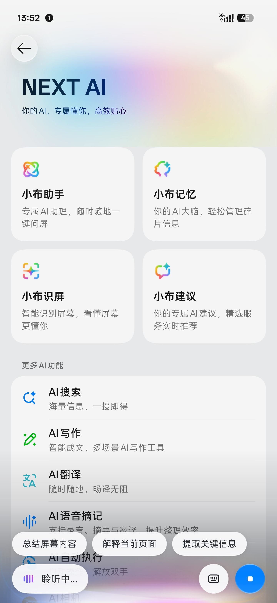
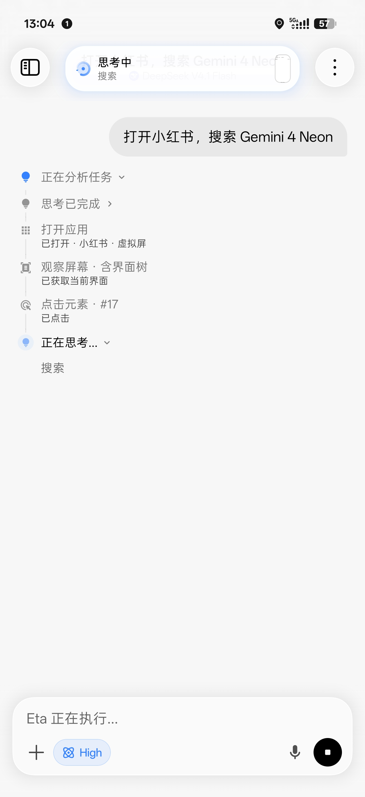
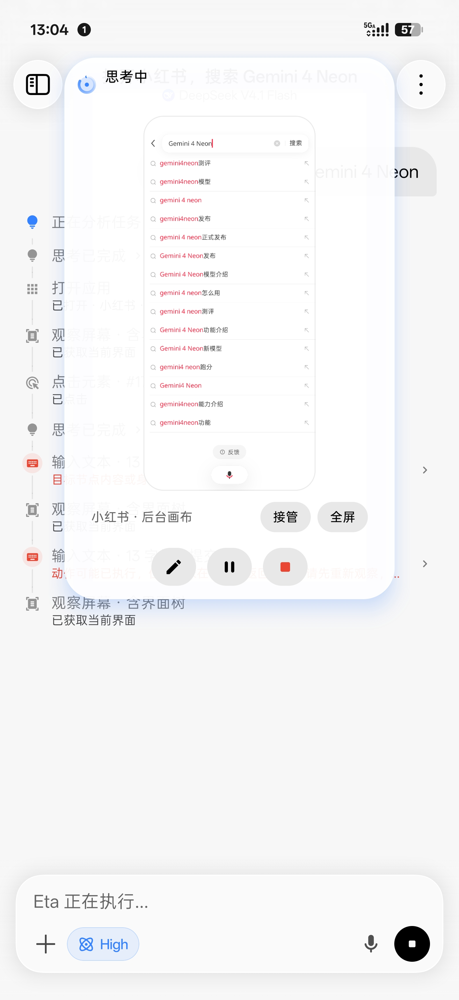
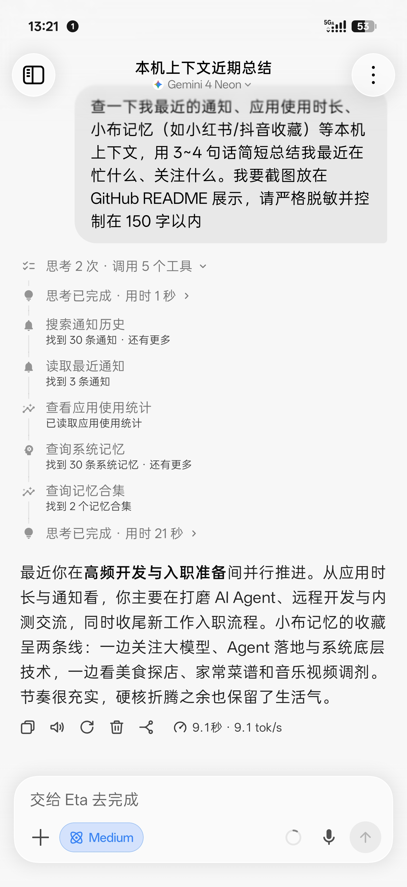
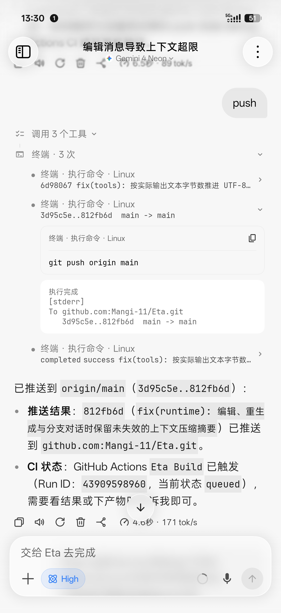
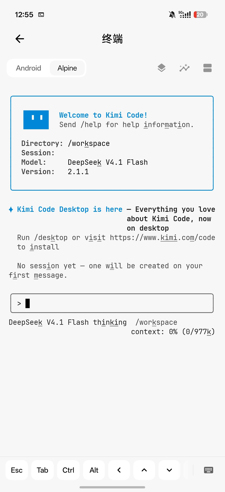
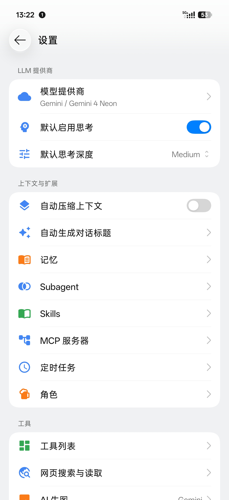
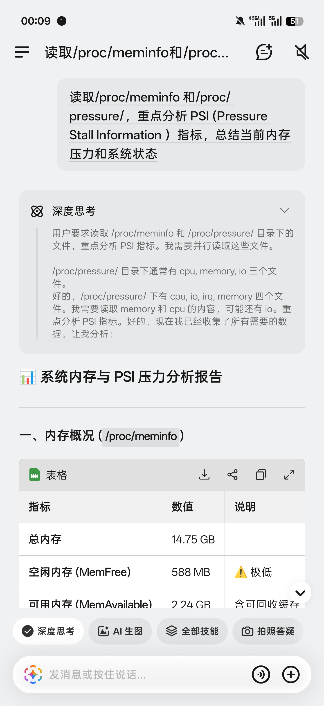
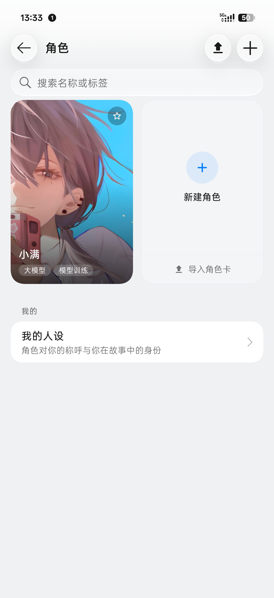

# Eta

[简体中文](README.md) | **English**

**A system-level AI assistant and mobile agent for Android in the LLM era.**

**Eta** is an AI agent built for phones and mobile devices, combining the autonomous planning and execution of coding agents like [Codex](https://openai.com/codex/) with the cross-app GUI experience of [Doubao Phone Assistant](https://o.doubao.com/).

Benchmarked against built-in OEM system assistants, Eta integrates deeply with Android system services, OEM ROMs, and on-device data—**aiming to deliver a true AI phone experience for the LLM era**:

- **Comprehensive personal context**: taps directly into system data, OEM data, and **Xiaobu Memory** (including saved Xiaohongshu, Douyin, and Bilibili posts & video summaries) to retrieve notifications, SMS & OTPs, calls, photos (text & visual search), recording summaries, notes, health data, clipboard, chat images, bills, itineraries, delivery orders, and more.
- **Native system & first-party actions**: calls Android APIs and native first-party interfaces to manage calendar events, alarms, timers, system notes, and device controls, while running cross-app tasks silently on a trusted background **virtual display**.
- **Native digital assistant & system entry points**: set Eta as Android's default digital assistant to wake it with screen context from the power button (succeeding earlier Xposed hooks for Breeno and Super XiaoAI), with Android 16+ Live Updates / Fluid Cloud, plus power-button routing (Eta or Gemini) and Google Circle to Search on compatible ROMs.
- **Full Agent Runtime & extensions**: implements its own Agent Runtime and Agent Loop, with parallel Subagents, scheduled tasks, a mobile PTY terminal & Linux environment, AI image generation, long-term memory, Skills, MCP, and Tavern character companionship.

Bring your own **API key (BYOK)** or sign in with a **Codex (ChatGPT) / Grok subscription**—you choose the model. Requires **Android 14+** across phone brands, with core features available without root; Root and LSPosed unlock the background virtual display, deep personal context, and ROM entry points.

[Download APK](https://github.com/Mangi-11/Eta/releases) · [Use Cases](#what-you-can-ask-eta) · [Capabilities](#core-capabilities) · [Permissions](#permissions--device-support) · [Getting Started](#getting-started) · [Why I Built Eta](docs/WHY_ETA_EN.md)

## What You Can Ask Eta

- **Power-button screen Q&A & in-place actions** — *Long-press the power button to ask directly about what's on screen, or have Eta fill out forms, write and submit delivery reviews, and handle other tasks right in the current app.*
- **On-device Android tinkering & Magisk modules** — *"Inspect my phone's current system properties and config files, write a Magisk module tailored to this device, package it, and flash it directly."*
- **Device troubleshooting & live debugging** — *Hit a weird phone issue like battery drain, missing notifications, permission conflicts, or an app crash? Have Eta inspect system state, pull recent logcat logs, or analyze the APK to pinpoint and resolve it.*
- **Vibe Coding right on your phone** — *Write code, build projects, clone repos, and run tests anywhere using a full Linux environment and Android's own root shell, or run Claude Code and Codex in the touch PTY terminal; when building Android apps or system modules, the agent can inspect live device state, system internals, and even decompile system components right on the device.*
- **Tap into Xiaobu Memory & personal data** — *"Pull my saved Xiaohongshu guides, Douyin video summaries, bills, and flight orders from Xiaobu Memory, build next week's itinerary into my calendar, and set an alarm for departure morning."*
- **Run cross-app tasks quietly in the background** — *Skip hunting through menus in unfamiliar or rarely used apps—for example, "Open my airline app, find seat selection, and pick a window seat while I keep watching my video; hand it over at the confirmation screen."*
- **Scheduled briefings & parallel research** — *"Every morning at 8 AM, compile yesterday's notifications and today's schedule and alert me on changes—or spin up multiple Subagents to research in parallel."*
- **Emotional companionship & character roleplay** — *Create your own character or import SillyTavern cards with worldbooks and isolated story memory; backed by your phone's personal context, your companion understands your daily life and can check your schedule, set alarms, or operate apps directly.*

## See It in Action

| Native Power-Button Wake | Background Virtual Display | Live Virtual Display Preview & Takeover |
| :---: | :---: | :---: |
|  |  |  |

| Comprehensive Personal Context | Mobile Vibe Coding | Touch PTY Terminal |
| :---: | :---: | :---: |
|  |  |  |

| Settings | Breeno Takeover (Legacy) | Characters & Companionship |
| :---: | :---: | :---: |
|  |  |  |

## Core Capabilities

### System-Level Assistant & Personal Context

- **Comprehensive Personal Context**: Retrieves notification history, calendar, location, SMS & OTPs, contacts, call logs, photos (OCR text & visual search), recordings, clipboard, health summaries, and chat images. On ColorOS, Eta also connects directly to **Xiaobu Memory** and **ColorOS Aggregated Search Service (DMP)**—opening up your saved Xiaohongshu / Douyin / Bilibili posts and video summaries, voice notes, memory collections, bills, itineraries, delivery orders, notes, recording summaries, and saved places to any model you choose.
- **Native System & 1st-Party Actions**: Calls Android and first-party app APIs directly to manage calendars, alarms, timers, system notes, and device controls (brightness, volume, DND, flashlight, Wi-Fi, Bluetooth, hotspot, NFC, app freezing, etc.).
- **Native Digital Assistant & Entry Points**: Set Eta as Android's default digital assistant for power-button wake with screen context (succeeding earlier Xposed hooks for Breeno and Super XiaoAI); supports Android 16+ Live Updates / Fluid Cloud / Super Island, hold-to-talk ASR (Qwen / Doubao / MiMo / DeepSeek), and multi-engine TTS; compatible ROMs add power-button routing (Eta, Gemini, or OEM default, with automatic default-assistant syncing) and Google Circle to Search (handle long press / two-finger press).
- **GUI & Background Virtual Display**: Combines accessibility and lossless screenshots for cross-app control; operates in place on the main screen, or defaults to a silent trusted background virtual display with Root or LSPosed, with a live miniature preview in the top capsule for instant takeover or one-tap handoff to the main screen.

### Autonomous Orchestration & Mobile Toolbox

- **Parallel Subagents**: Runs multiple isolated Subagents concurrently (built-in `explore`, `coder`, `plan`, plus custom templates), with optional lighter Secondary Model selection and live step inspection in chat.
- **Scheduled Tasks**: Supports one-time, recurring, and Cron background execution with change-only alerts or silent archiving—creatable and manageable directly in conversation.
- **Mobile Terminal, Linux & Vibe Coding**: Delivers full desktop-grade Coding Agent capabilities—file editing, search, and shell execution—backed by a complete Alpine / Debian Linux environment (rootless PRoot or root chroot) so you can write code and build projects freely on your phone; also includes a PTY console independently redesigned and built for mobile touch devices that runs TUIs such as Claude Code and Codex, alongside background daemons and file management.
- **Web Browser & AI Image Generation**: Web search plus a takeover-ready built-in browser; native text-to-image and image editing across 6 providers (Gemini, OpenAI, xAI, Doubao, Qwen, SiliconFlow) with chat cards and a gallery.

### Models, Extensions & Daily UX

- **Model Ecosystem**: Supports OpenAI (Chat Completions / Responses), Anthropic, and Gemini (including Google Cloud Vertex AI) protocols; includes 12 built-in providers, custom endpoints, `models.dev` catalog import, and **Codex (ChatGPT) / Grok subscription sign-in**.
- **Emotional Companionship & Tavern Ecosystem**: Create custom characters and stay compatible with the SillyTavern ecosystem—supporting PNG / JSON character card import & export, user personas, embedded worldbooks, isolated story memory, and in-place editing/regeneration—while still accessing your phone's personal context and tools.
- **Memory & Extensions**: Local `MEMORY.md` long-term memory, Skills from GitHub or ZIP, and remote Streamable HTTP MCP tools.
- **Native Polish**: Mid-run queuing and steering, conversation branching, native LaTeX math rendering, a native **Miuix** UI, and English / Simplified / Traditional Chinese localization.

## Where Eta Fits

Most mobile AI tools today fall into two camps:

- **Built-in OEM assistants** have native power-button entry points, first-party APIs, and private on-device data, but remain closed—locked to vendor models and predefined workflows.
- **Third-party mobile agents** already do well with BYOK models, Linux sandboxes, Skills, and standard OS permissions, yet most remain standalone apps built on generic interfaces—rarely reaching deep into Android internals, OEM ecosystems, or system-level entry points.

**Eta aims to bridge both worlds**: pairing open model choice and full autonomous agent capabilities (parallel Subagents, scheduled tasks, a touch PTY terminal & Linux, AI image generation, Skills, MCP, and Tavern character companionship) with deep Android and ROM integration—bringing a native digital assistant entry point, trusted background virtual display, comprehensive personal context, and root-level device control into one runtime.

> Read the full story behind Eta, mobile AI ecosystem boundaries, and our long-term vision in **[Why I Built Eta](docs/WHY_ETA_EN.md)**.

## Permissions & Device Support

- **Standard Device (No Root)**: Full chat & models, emotional companionship & Tavern character cards, AI image gen, Subagents, scheduled tasks, memory / Skills / MCP, web & browser, standard terminal & PRoot Linux, calendar / notifications / location / app usage, main-screen GUI, and Eta native digital assistant.
- **Rooted Device**: Background virtual display, system controls & native 1st-party actions (alarm management / notes), app management, deep personal context (SMS / calls / photo content search / health / chat images), and root shell & chroot.
- **LSPosed + Compatible ROM**: Background virtual display, ColorOS / HyperOS power-button routing (Eta or Gemini), direct Xiaobu Memory access, and Google Circle to Search (handle long press / two-finger press).

See [Device Support & Permissions](docs/ROOTLESS_SUPPORT.md) for full details.

## Getting Started

1. Download and install the APK from [Releases](https://github.com/Mangi-11/Eta/releases), then open **Model providers** to configure an API key (or sign in with Codex / Grok) and add a model.
2. Open **Permissions** to grant the permissions you need, and enable autostart and lock Eta in Recents in your system settings.
3. *(Optional)* Open **Linux tool environment** to install a Linux distribution and common tools.
4. *(Optional, for Root / LSPosed devices)* Grant Root access to Eta, activate the Eta module in LSPosed Manager, select the required scopes, and reboot your device.

> **Privacy note**: Task context, images, and tool outputs are sent to your configured model provider. Raw results from sensitive and MCP tools are excluded from local chat history, and conversations support Markdown export and full backup/restore.

## Documentation

*(Implementation docs below are in Chinese unless noted otherwise.)*

- [Why I Built Eta](docs/WHY_ETA_EN.md) — Motivation, mobile AI ecosystem observations, and Agentic OS vision *(English)*
- [Device Support & Permissions](docs/ROOTLESS_SUPPORT.md) — Rootless / Root / LSPosed scope and background limits
- [Technical Implementation](docs/TECHNICAL.md) — Device tools, personal data retrieval, browser, terminal, and system integration
- [Agent Runtime](docs/AGENT_RUNTIME.md) — Agent loop, providers, steering, file tools, and recovery
- [Voice Setup](docs/VOICE.md) — Online speech recognition and synthesis configuration
- [Characters](docs/CHARACTERS.md) — Tavern card compatibility, worldbooks, and story memory
- [HyperOS System Entry](docs/HYPEROS_SYSTEM_ENTRY.md) — Power-button routing and Circle to Search on HyperOS
- [Native Terminal Components](docs/TERMINAL_NATIVE.md) — Building bundled PTY and PRoot components

## Pull Requests and Contributing

External pull requests are closed; only collaborator commits are accepted.

In the AI era, handling external PRs has become harder than before: among the many AI-generated PRs, model capabilities and contributor skill levels vary widely, making it easy for AI slop to slip in. Coupled with a tedious workflow—aligning on architecture, going back and forth in discussions, and still having to review the code and test it ourselves—it is exhausting and costs far more than implementing an issue internally with AI. It is easier to just write it ourselves.

For feature requests, bug reports, or contributions, feel free to share your ideas or **prompts** directly in [Issues](https://github.com/Mangi-11/Eta/issues) and issue comments so AI can read the context and implement them directly. Thank you for your understanding and support!

## Star History

  <a href="https://www.star-history.com/#Mangi-11/Eta&amp;Date">
    <picture>
      <source media="(prefers-color-scheme: dark)" srcset="https://api.star-history.com/svg?repos=Mangi-11/Eta&amp;type=Date&amp;theme=dark">
      
    </picture>
  </a>

## References and Acknowledgements

- [Pi Coding Agent](https://github.com/earendil-works/pi): the main reference for Eta's agent runtime, including the agent loop, tool calling, steering, and transcript state management.
- [OmniBot](https://github.com/omnimind-ai/OmniBot): a reference project for AI agents on Android.
- [libxposed API](https://github.com/libxposed/api): the modern Xposed API.
- [Miuix](https://github.com/compose-miuix-ui/miuix): UI component library.

## License

Copyright © 2026 [蛮吉 (Mangi-11)](https://github.com/Mangi-11)

This project is open source under GPL-3.0; see [LICENSE](LICENSE) for details.

Community: <a href="https://linux.do">LINUX DO</a>
